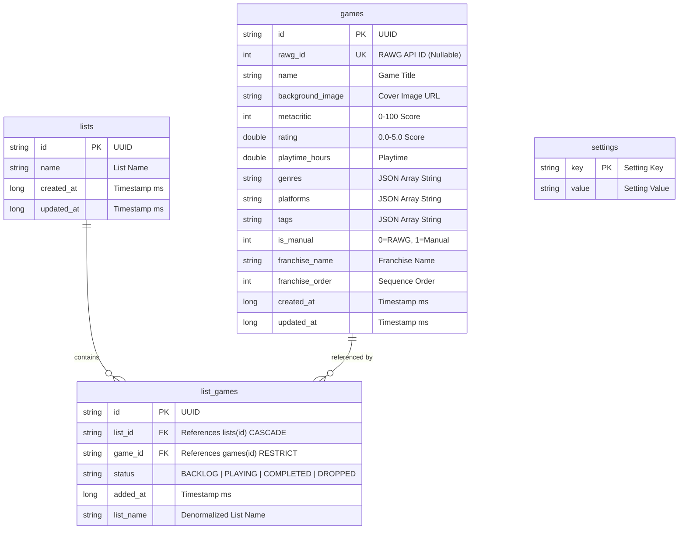
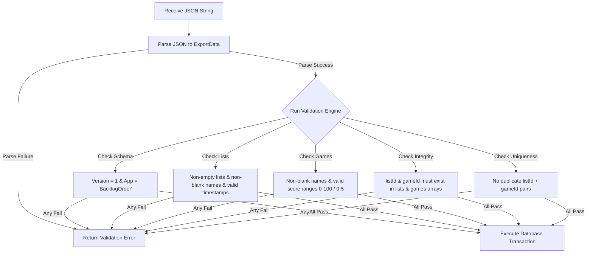
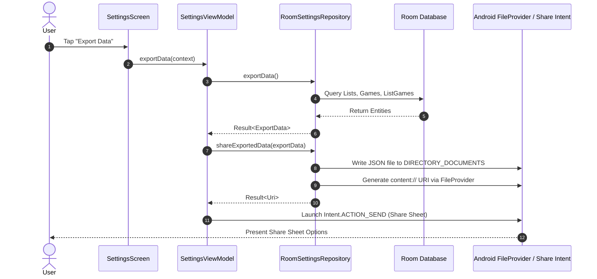

# BacklogOrder Database & Export System Architecture

This document provides a comprehensive analysis of the **Listing & Games Database** and the **Export/Import System** in the **BacklogOrder** Android application.

---

## 1. Listing & Games Database Architecture

The data layer in BacklogOrder is powered by the **Room Persistence Library** (`BacklogOrderDatabase`), providing structured local storage, relational mappings, and reactive streams via Kotlin `Flow`.

### 1.1 Technology Stack & Database Setup

- **Database Class**: [BacklogOrderDatabase](file:///home/miguel/AndroidStudioProjects/BacklogOrder/app/src/main/java/com/backlogorder/data/local/BacklogOrderDatabase.kt)
- **Database Name**: `backlogorder.db` (Version 1)
- **Migration Strategy**: `fallbackToDestructiveMigration()`
- **Type Converters**: [StringListConverter](file:///home/miguel/AndroidStudioProjects/BacklogOrder/app/src/main/java/com/backlogorder/data/local/StringListConverter.kt) converts Kotlin `List<String>` properties (`genres`, `platforms`, `tags`) to and from JSON array strings (e.g., `["RPG", "Action"]`).

---

### 1.2 Entity Specifications & Relational Schema

The database consists of five core tables defined in [Entities.kt](file:///home/miguel/AndroidStudioProjects/BacklogOrder/app/src/main/java/com/backlogorder/data/local/Entities.kt):



#### 1. `ListEntity` (`lists`)
Represents user-created game lists (e.g., "Favorites", "Backlog 2025").
- **Primary Key**: `id` (String UUID)
- **Columns**: `name`, `created_at`, `updated_at`
- **Domain Mapping**: Maps to [GameList](file:///home/miguel/AndroidStudioProjects/BacklogOrder/app/src/main/java/com/backlogorder/domain/model/GameList.kt) via `toDomain()`.

#### 2. `GameEntity` (`games`)
Represents game titles stored locally, sourced either from the RAWG API or added manually by the user.
- **Primary Key**: `id` (String UUID)
- **Unique Index**: `rawg_id` (Integer, nullable). Ensures no duplicate RAWG games are stored.
- **Columns**: `name`, `background_image`, `metacritic`, `rating`, `playtime_hours`, `genres`, `platforms`, `tags`, `is_manual` (0 for RAWG, 1 for Manual), `franchise_name`, `franchise_order`, `created_at`, `updated_at`.
- **Domain Mapping**: Maps to [Game](file:///home/miguel/AndroidStudioProjects/BacklogOrder/app/src/main/java/com/backlogorder/domain/model/Game.kt) via `toDomain()`.

#### 3. `ListGameEntity` (`list_games`)
Junction table managing the Many-to-Many relationship between lists and games.
- **Primary Key**: `id` (String UUID)
- **Foreign Keys**:
  - `list_id` -> `lists(id)` with `onDelete = ForeignKey.CASCADE`. Deleting a list automatically deletes all corresponding `list_games` junction entries.
  - `game_id` -> `games(id)` with `onDelete = ForeignKey.RESTRICT`. Direct deletion of referenced games is restricted to prevent orphan links.
- **Indices**:
  - Unique index `[list_id, game_id]` prevents a single game from being added to the same list more than once.
  - Foreign key indices on `[list_id]` and `[game_id]` optimize join query performance.
- **Columns**: `status` (`BACKLOG`, `PLAYING`, `COMPLETED`, `DROPPED`), `added_at`, `list_name` (denormalized for convenience).
- **Domain Mapping**: Maps to [ListEntry](file:///home/miguel/AndroidStudioProjects/BacklogOrder/app/src/main/java/com/backlogorder/domain/model/ListEntry.kt) via `toDomain(game)`.

#### 4. `SettingsEntity` (`settings`)
Key-value storage for app configurations (theme selection, dark mode toggle, custom accent colors, onboarding status).

---

### 1.3 Data Access Objects (DAOs) & Repositories

Defined in [Daos.kt](file:///home/miguel/AndroidStudioProjects/BacklogOrder/app/src/main/java/com/backlogorder/data/local/Daos.kt):

- **`ListDao`**: Manages list CRUD operations and emits reactive lists via `observeLists(): Flow<List<ListEntity>>`.
- **`GamesDao`**:
  - **Game Deduplication Lookup**: `findByRawgId(rawgId)` finds existing API games by RAWG ID; `findManualByName(name)` performs a case-insensitive lookup (`LOWER(name) = LOWER(:name)`) for manual entries.
  - **Junction Operations**: Queries for entries in lists (`observeEntriesForList`, `observeAllEntries`), updates statuses (`updateStatus`), sets franchise metadata (`setFranchise`).
  - **Batch Clears**: `deleteAllGames()`, `deleteAllListGames()`.
- **`SettingsDao`**: Operates on settings values and provides reactive flows for UI settings.

#### Repository Layer Logic

1. **Game Deduplication** ([RoomGamesRepository](file:///home/miguel/AndroidStudioProjects/BacklogOrder/app/src/main/java/com/backlogorder/data/repository/RoomGamesRepository.kt)):
   When adding a game to a list (`addGameToList`):
   - Check if the game exists via `rawgId` (if present) or by case-insensitive name match (for manual games).
   - If the game exists, reuse its existing `gameId`. If not, insert a new `GameEntity`.
   - Check if a `list_games` entry already exists for `(listId, gameId)`. If so, update the game's status. If not, create a new `ListGameEntity`.

2. **List Deletion Safety** ([RoomListsRepository](file:///home/miguel/AndroidStudioProjects/BacklogOrder/app/src/main/java/com/backlogorder/data/repository/RoomListsRepository.kt)):
   - Deleting a list (`deleteList`) deletes only its `list_games` junction rows via foreign key `CASCADE`.
   - The actual `GameEntity` records in the `games` table remain untouched so that games shared across multiple lists are preserved.

---

## 2. Export & Import System Architecture

BacklogOrder features a robust, schema-validated JSON Export/Import system designed according to [export-schema-v1.md](file:///home/miguel/AndroidStudioProjects/BacklogOrder/docs/export-schema-v1.md).

### 2.1 Export Schema Specifications (v1)

Defined in [ExportData.kt](file:///home/miguel/AndroidStudioProjects/BacklogOrder/app/src/main/java/com/backlogorder/domain/ExportData.kt):

```json
{
  "version": 1,
  "app": "BacklogOrder",
  "exportedAt": 1735689600000,
  "lists": [
    {
      "id": "550e8400-e29b-41d4-a716-446655440000",
      "name": "Backlog",
      "createdAt": 1735689600000,
      "updatedAt": 1735689600000
    }
  ],
  "games": [
    {
      "id": "123e4567-e89b-12d3-a456-426614174000",
      "rawgId": null,
      "name": "Hollow Knight",
      "backgroundImage": null,
      "metacritic": 90,
      "rating": 4.8,
      "playtimeHours": 35.0,
      "genres": ["Platformer", "Indie"],
      "platforms": ["PC", "Switch"],
      "tags": ["Metroidvania"],
      "isManual": true,
      "franchiseName": "Hollow Knight",
      "franchiseOrder": 1,
      "createdAt": 1735689600000,
      "updatedAt": 1735689600000
    }
  ],
  "listGames": [
    {
      "id": "987e6543-e21b-12d3-a456-426614174000",
      "listId": "550e8400-e29b-41d4-a716-446655440000",
      "gameId": "123e4567-e89b-12d3-a456-426614174000",
      "status": "BACKLOG",
      "addedAt": 1735689600000
    }
  ]
}
```

#### Core Data Transfer Objects (DTOs)
- **`ExportData`**: Root object containing `version` (must be `1`), `app` (must be `"BacklogOrder"`), `exportedAt`, `lists`, `games`, and `listGames`.
- **`ExportedList`**: Represents exported lists.
- **`ExportedGame`**: Represents exported games (exports manual games with `isManual = true`).
- **`ExportedListGame`**: Represents relationships between lists and games, preserving game status (`BACKLOG`, `PLAYING`, `COMPLETED`, `DROPPED`).

---

### 2.2 Validation Engine (`ValidationResult`)

Before any imported data is written to the database, it undergoes rigorous validation via `ValidationResult.validate(data)` in [ExportData.kt](file:///home/miguel/AndroidStudioProjects/BacklogOrder/app/src/main/java/com/backlogorder/domain/ExportData.kt):



#### Validation Rules:
1. **Schema Header Validation**: `version` must equal `1`, `app` must equal `"BacklogOrder"`, `lists` array must not be empty.
2. **List Validation**: Name cannot be blank; `createdAt` and `updatedAt` must be positive timestamps.
3. **Game Validation**: Name cannot be blank; `createdAt` and `updatedAt` must be positive; `metacritic` must be within `0..100`; `rating` must be within `0.0..5.0`; `playtimeHours` must be `>= 0.0`.
4. **Relational Integrity**:
   - Every `listId` in `listGames` must reference a valid list ID present in the `lists` array.
   - Every `gameId` in `listGames` must reference a valid game ID present in the `games` array.
   - `listId` and `gameId` cannot be identical.
   - Duplicate `(listId, gameId)` pairs are rejected.

---

### 2.3 Export Workflow

The export flow is managed by [RoomSettingsRepository](file:///home/miguel/AndroidStudioProjects/BacklogOrder/app/src/main/java/com/backlogorder/data/repository/RoomSettingsRepository.kt) and triggered from [SettingsViewModel](file:///home/miguel/AndroidStudioProjects/BacklogOrder/app/src/main/java/com/backlogorder/ui/settings/SettingsScreen.kt):



1. **Extraction**: `RoomSettingsRepository.exportData()` fetches all lists, games (filtering for manual games `isManual == 1`), and active junction mappings.
2. **Serialization**: Encodes `ExportData` to JSON string formatted via `kotlinx.serialization`.
3. **File Writing**: Writes file to external documents directory (`BacklogOrder_Export_<timestamp>.json`).
4. **Sharing**: Obtains a secure `content://` URI using Android `FileProvider` (`${context.packageName}.fileprovider`) and opens the Android native Share Sheet (`Intent.ACTION_SEND`).

---

### 2.4 Import Workflow & Transactional Safety

Importing data is fully **transactional** and **idempotent**:

1. **JSON Parsing & Validation**:
   - Input JSON is deserialized using `Json { ignoreUnknownKeys = true; coerceInputValues = true }`.
   - `ValidationResult.validate(importData)` evaluates the schema rules. If invalid, the operation halts immediately and returns `Result.failure(AppError.Validation(...))`. No database writes occur.
2. **Atomic Execution**:
   - The database replacement is wrapped in `database.withTransaction { ... }`:
     ```kotlin
     database.withTransaction {
         database.gamesDao().deleteAllListGames()
         database.gamesDao().deleteAllGames()
         database.listDao().deleteAllLists()

         // Insert imported lists, games, and unique list-game relationships
     }
     ```
   - If any step inside the transaction fails or throws an exception, Room automatically rolls back all changes, ensuring zero risk of database corruption.

---

### 2.5 CSV Import Utility

The project also includes a standalone utility [CsvParser](file:///home/miguel/AndroidStudioProjects/BacklogOrder/app/src/main/java/com/backlogorder/util/CsvParser.kt) for parsing raw CSV content. It properly handles:
- Quoted strings and escaped double quotes (`""`)
- Multi-line cell text and varying line endings (`\r\n` and `\n`)
- Comma separators outside of quoted bounds

---

## 3. Summary Matrix

| Feature | Implementation Component | Key Guarantee / Behavior |
|---------|-------------------------|--------------------------|
| **Database Engine** | Room (`BacklogOrderDatabase`) | Relational SQLite store with type converters for JSON list properties |
| **Game Deduplication** | `RoomGamesRepository.addGameToList` | Matches existing games by `rawg_id` or case-insensitive manual name |
| **Cascade Deletes** | `ListGameEntity` (`ForeignKey.CASCADE`) | Deleting a list removes junction links without deleting shared games |
| **Export Format** | `ExportData` (Schema v1) | Standardized JSON output containing version header, lists, games, and junction links |
| **Validation Engine** | `ValidationResult` | Verifies schema version, value ranges, positive timestamps, and foreign key references |
| **Import Integrity** | `database.withTransaction` | Atomic database restoration; complete rollback on any error |
| **File Sharing** | `FileProvider` + `Intent.ACTION_SEND` | Secure file sharing via Android `content://` URIs |
